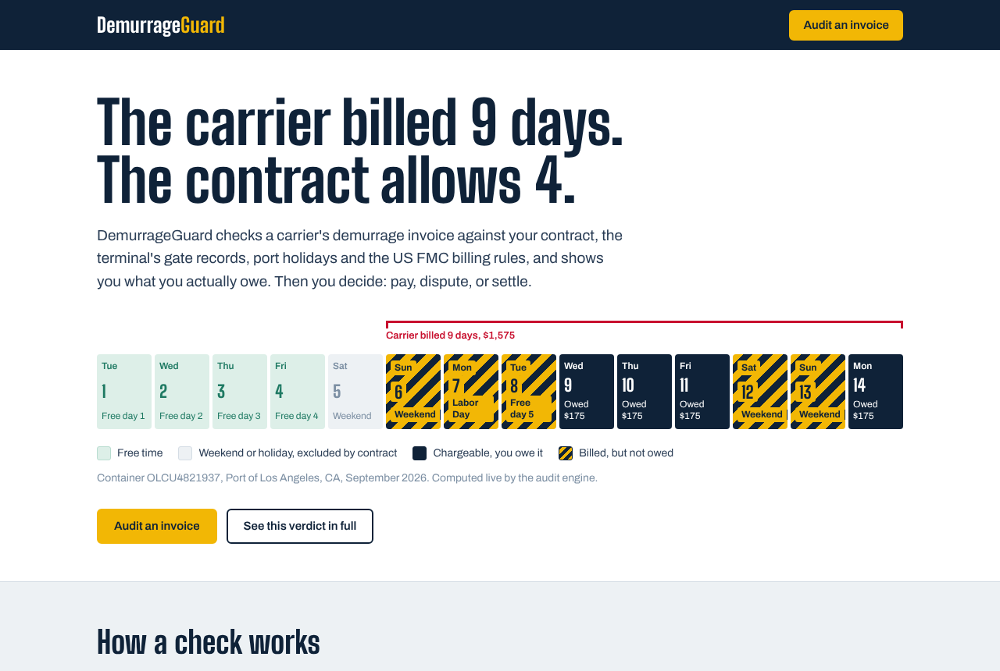
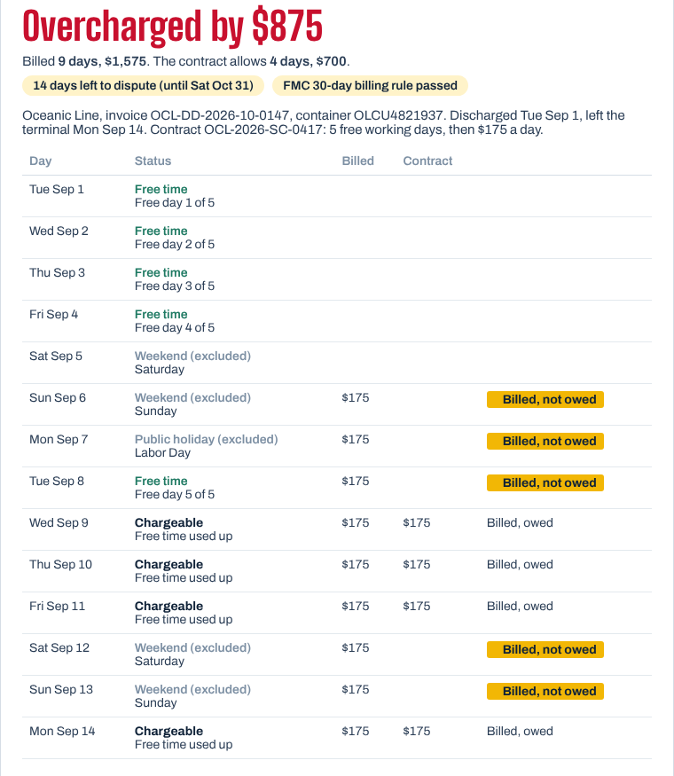

# DemurrageGuard

**AI reads the invoice. Code proves the math. A human decides.**

Shipping lines charge importers a daily fee (demurrage) when a container stays at the port past its free
time. Contracts usually say weekends, public holidays and port closures don't count, but carriers bill them
anyway. US Federal Maritime Commission rules (46 CFR Part 541) also require carriers to bill within 30 days
of the last charge, and give importers 30 days to dispute. Checking every invoice by hand takes hours, so
most teams just pay.

DemurrageGuard checks a carrier invoice in about a minute and leaves the business decision to a person.

Agentika 2.0 / NaSCon 2026. Theme: **Human + AI: Better Together**.

## Try it

| | Link |
|---|---|
| Landing page, sample verdicts, decision log | https://alternate-glowing-serpent-8906-github-app.alternatefutures.ai |
| Audit an invoice (upload a PDF) | https://n8n-j3bs-app.alternatefutures.ai/form/audit |
| Sample invoices to upload | [A, overcharged](https://alternate-glowing-serpent-8906-github-app.alternatefutures.ai/samples/invoice_A_overcharged.pdf), [B, correct](https://alternate-glowing-serpent-8906-github-app.alternatefutures.ai/samples/invoice_B_correct.pdf), [C, sent too late](https://alternate-glowing-serpent-8906-github-app.alternatefutures.ai/samples/invoice_C_late_fmc.pdf) |

No login needed. Both services run on Alternate Clouds.



## What happens when you audit an invoice

1. **Upload.** The manager uploads the carrier's PDF on the audit page.
2. **AI reads it.** A language model pulls out the carrier, container, dates, days billed and amounts.
   If it can't read something, the manager is asked to fill it in.
3. **Code checks every day.** The audit engine applies the contract's free time, skips weekends,
   holidays and port closures, compares against the terminal's gate records, and checks the FMC
   30-day rules. An AI agent runs the same check through the engine's MCP server, and a guard confirms
   both answers match. If they ever disagree, the code wins.
4. **The manager decides.** The verdict page shows every day, what was billed and what is owed, plus
   the AI's recommendation. The manager picks pay, dispute in full or a partial dispute, and says why.
5. **AI drafts, code checks, human approves.** The AI writes the dispute letter from the engine's facts.
   Code checks that every dollar amount in it came from the engine; if not, a verified template is used.
   The manager edits and approves it.
6. **Logged.** Every decision is recorded, including each time the manager overrode the AI.



| Who | Does what | Why |
|---|---|---|
| AI | Reads messy PDFs, recommends, drafts letters | Good at language, bad at arithmetic |
| Code | Every date and every dollar | Must be exact and checkable |
| Person | Pay, dispute or settle; signs off the letter | Knows the carrier relationship and any fault on their own side |

**The example (invoice A):** container discharged Tue Sep 1, 2026, with 5 free working days and
$175/day after that, collected Mon Sep 14. The carrier billed Sep 6 to 14: 9 days, $1,575. Sep 6, 12 and 13
are weekends, Sep 7 is Labor Day, and Sep 8 is still free day 5. Only Sep 9, 10, 11 and 14 are chargeable:
**$700, so the carrier overcharged by $875.**

## How it's built

```
                         Alternate Clouds
 ┌──────────────────────────────────────────────────────────────────────┐
 │  n8n service (official n8n template)                                 │
 │   Form: upload PDF ─▶ Extract text ─▶ Groq LLM: read invoice fields  │
 │        ─▶ HTTP POST /audit ──────────────┐                           │
 │        ─▶ AI agent ─ MCP client ─────────┤                           │
 │        ─▶ Guard: agent result == REST result?                        │
 │        ─▶ Form: verdict + decision (HUMAN)                           │
 │        ─▶ Groq LLM: draft letter ─▶ POST /letter/check (guard)       │
 │        ─▶ Form: edit + approve (HUMAN) ─▶ POST /decisions            │
 │                                          │                           │
 │  Engine service (this repo, Docker)      ▼                           │
 │   FastAPI: /audit /letter /letter/check /decisions, MCP at /mcp      │
 │   Pure-Python rules: contract, gate records, port calendar, FMC      │
 │   Pages: landing, sample verdicts, decision log                      │
 └──────────────────────────────────────────────────────────────────────┘
```

| Layer | Technology |
|---|---|
| Workflow, forms, human approval steps | n8n (Form Trigger, Form pages, IF/Switch, Code, HTTP Request) |
| AI | Groq API, `openai/gpt-oss-120b`: Information Extractor, AI Agent, LLM Chain |
| Tool protocol | MCP over streamable HTTP (Python MCP SDK, `FastMCP`), called by n8n's MCP Client Tool |
| Audit engine | Python 3.12, FastAPI, Uvicorn; no database, no secrets, no AI inside |
| Hosting | Alternate Clouds: engine built from this repo's Dockerfile, n8n from the platform template |

## Repo layout

```
engine/
  logic.py        the audit rules (pure functions, fully tested)
  app.py          REST endpoints, MCP server, page routes
  ui.py           landing page, sample verdict pages, decision log
  data/           fictional contracts, terminal gate records, port holidays
  static/fonts/   self-hosted typefaces (also used by the n8n forms)
n8n/demurrage-guard.json   the n8n workflow (import into n8n)
samples/          the three demo invoice PDFs
tests/            pytest suite
tools/            scripts that generate the sample PDFs and the workflow file
docs/             runbook, demo script, screenshots
Dockerfile        engine image (port 8000)
```

## Engine API

| Endpoint | Purpose |
|---|---|
| `GET /` | Landing page with live sample verdicts and the decision log |
| `GET /demo/A`, `/demo/B`, `/demo/C` | Full verdict for a sample invoice |
| `POST /audit` | `{"invoice": {...}, "as_of_date": "YYYY-MM-DD"}` returns the full audit (always HTTP 200; check `ok`) |
| `POST /letter`, `POST /letter/check` | Facts the AI may use; guard for an AI-drafted letter |
| `POST /decisions`, `GET /decisions` | Decision log |
| `/mcp` | MCP tools: `audit_invoice`, `get_contract`, `get_gate_events`, `get_calendar`, `check_fmc_window` |
| `GET /health`, `GET /docs` | Health check, OpenAPI docs |

## Run and operate

- Starting it after a break, updating it, and fixing problems: [docs/RUNBOOK.md](docs/RUNBOOK.md)
- Demo walkthrough: [docs/DEMO_SCRIPT.md](docs/DEMO_SCRIPT.md)

Run the engine locally (Windows PowerShell):

```powershell
python -m venv .venv
.\.venv\Scripts\Activate.ps1
pip install -r requirements-dev.txt
python -m pytest -q
uvicorn engine.app:app --port 8000      # http://localhost:8000
```

## Data and disclaimer

Carriers, contracts, containers, invoices and people are fictional demo data. The rules are simplified for
demonstration and are not legal advice.

## Credits

- [FastAPI](https://fastapi.tiangolo.com/) and [Uvicorn](https://www.uvicorn.org/) (MIT / BSD)
- [MCP Python SDK](https://github.com/modelcontextprotocol/python-sdk) (MIT)
- [n8n](https://n8n.io/) (Sustainable Use License) and its LangChain AI nodes
- [Groq](https://groq.com/) API with the open-weight `openai/gpt-oss-120b` model
- [ReportLab](https://www.reportlab.com/) for generating the sample PDFs (BSD)
- Typefaces [Big Shoulders Display](https://fonts.google.com/specimen/Big+Shoulders+Display) and
  [Archivo](https://fonts.google.com/specimen/Archivo), SIL Open Font License, via [Fontsource](https://fontsource.org)
- Hosted on [Alternate Clouds](https://clouds.alternatefutures.ai)
- AI coding assistance: Claude (Anthropic) helped write code and docs; the team reviewed, tested and deployed it.
